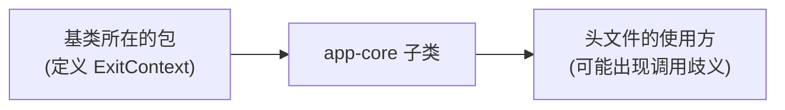

# C006 子类同名函数藏住父类虚函数（app-core ExitContext）

- **包**：app-core
- **告警标志**：[[Woverloaded-virtual]]
- **根因类别**：C++ 可见性
- **是否真 bug**：需看一眼

## 报错原文

典型形式（Clang 的诊断格式，不是本库某次日志的原文；补到真实日志后替换）：

```
<文件>:<行>: error: '<子类>::ExitContext' hides overloaded virtual function [-Werror,-Woverloaded-virtual]
```

## 解决方案（采用的修法）

在子类加 `using 基类::ExitContext;`，写在与基类原访问级别一致的区段；提交说明写明不改虚函数分派、不改 ABI。

## 备选与为什么没用

只对 Clang 在头文件里关掉该告警：语义不变、无歧义风险，但在公开头文件里压掉诊断；只有下游调用确实会歧义且不便改调用方时才退到这一步。

## 需联动看的模块

- **头文件 / 接口 / 输入的提供者**：基类所在的包：基类函数原本的访问级别和用意要到那里看
- **下游（依赖这个包、改了会受影响的）**：公开头文件的使用方：加 using 后下游传子类智能指针或 nullptr 时可能出现"调用有歧义"
- **同一根因的其它包或案例**：[[C007]] [[C019]]



## 要点

要人看三件事：基类函数原本的访问级别；基类是否本想通过虚函数调到子类的清理逻辑（若是，告警抓到的是真 bug）；下游传子类智能指针或 nullptr 时会不会出现"调用有歧义"。

## 来源

Tizen toolchain lld integration（2026-09）。入库前须补：CL 号、改动文件、修复内容摘要、验证记录（§7.2）。
