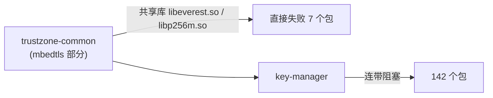

# C016 依赖库被编成共享库，连带一大片失败

- **包**：trustzone-common
- **告警标志**：（无对应告警标志）
- **根因类别**：构建配置
- **是否真 bug**：非 Clang 问题

## 报错原文

（原文待补：从对应轮次的失败日志里摘主错误行和编译器打印的源码行，不凭记忆填写。）

## 解决方案（采用的修法）

mbedtls 第三方部分因 `BUILD_SHARED_LIBS=ON` 被编成共享库（libeverest.so / libp256m.so），直接导致 7 个包失败、经 key-manager 连带阻塞 142 个；已反馈开发者。

## 备选与为什么没用

（无）

## 需联动看的模块

- **头文件 / 接口 / 输入的提供者**：mbedtls 第三方部分（`BUILD_SHARED_LIBS=ON` 被编成共享库 libeverest.so / libp256m.so）
- **下游（依赖这个包、改了会受影响的）**：直接失败 7 个包；经 key-manager 连带阻塞 142 个——先修源头，下游不要逐个分析
- **同一根因的其它包或案例**：—

## 要点

扩展错误里的"成片阻塞"要先找源头包，正是 §5.5 阻塞关系要算的东西。

## 来源

VD + Applied Clang 构建任务接管审计（2026-09）。入库前须补：CL 号、改动文件、修复内容摘要、验证记录（§7.2）。
