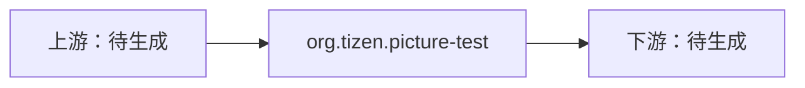

# org.tizen.picture-test

> 验收样本相关页：第 3a 批验收结束前不进知识库检索，实际修法也先不补进本页（HLD v0.8 §11 第 3 条）。

- **架构**：armv7l
- **构建 19091860 的失败**：[[C008]]（[[Wunused-private-field]]）
- **当时的实际修法**：待从 fix5 系列清单补录

## 报错原文

日志原文（构建 19091860；由 LogAnalyzer 从失败日志提取的文件、行号和消息原文，未含列号；本机用户名已换成 `<USER>`；编译器打印的源码行待内网补录）：

```
/home/<USER>/rpmbuild/BUILD/org.tizen.picture-test-0.3/src/ResultView.h:26: error: private field 'm_pText' is not used [-Werror,-Wunused-private-field]
```

另有 MessageView.h 第 24、26 行等。

## 依赖（第 3b 批由 §7.8 自动生成）

- **直接依赖**：待生成
- **直接下游**：待生成


